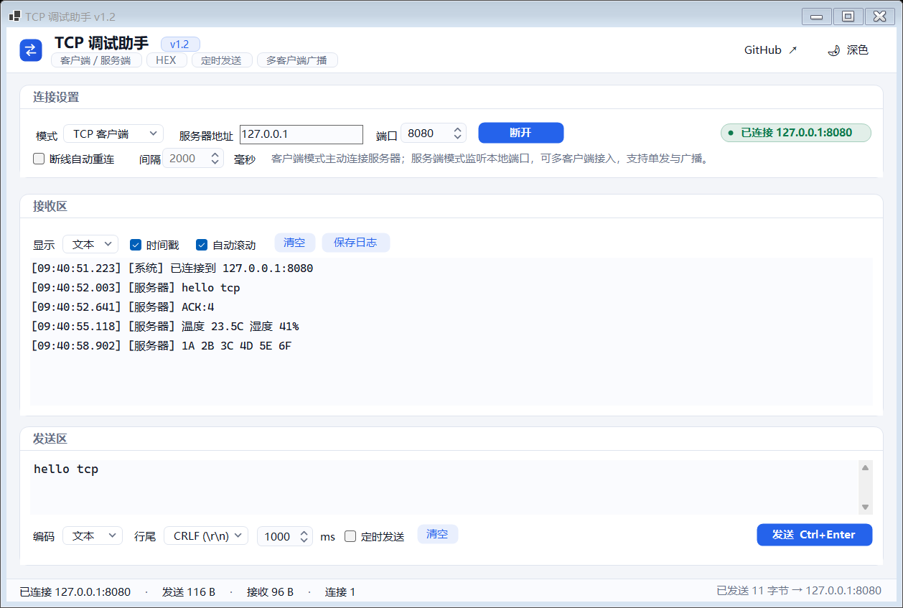
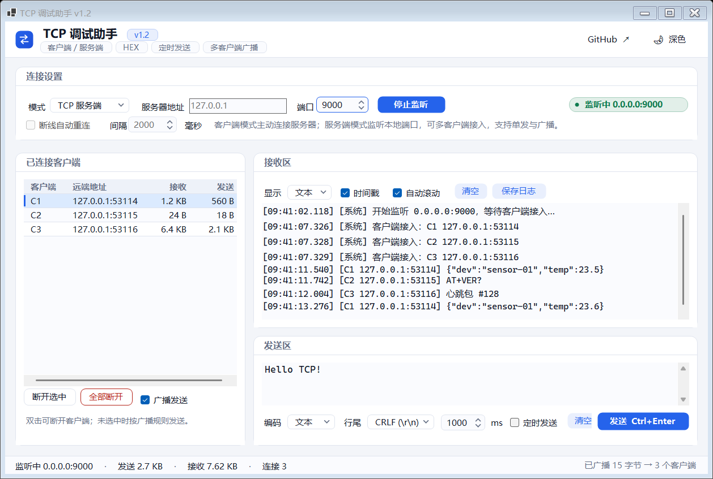
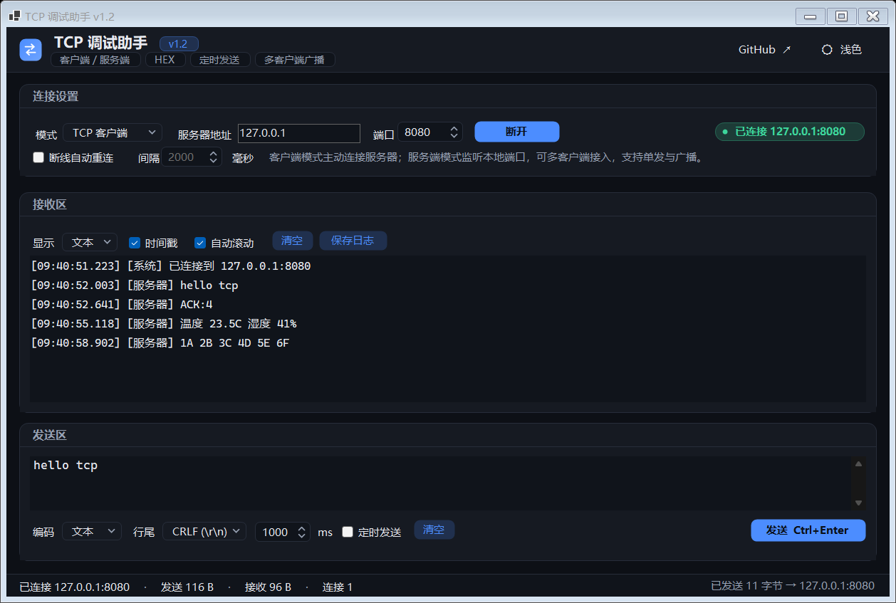

# TCP 调试助手（TCP Debug Assistant）

一个用 **C# / .NET 8 + WinForms** 写的轻量级 TCP 调试工具：既能当**客户端**连服务器，也能当**服务端**监听端口接受多个客户端，支持文本 / HEX 收发、定时发送、断线自动重连、多客户端单发与广播。

零第三方依赖，离线可构建，单个 exe 可直接运行。







---

## 功能

| 分类 | 能力 |
|---|---|
| 双模式 | TCP 客户端 / TCP 服务端一键切换 |
| 编码 | 文本（UTF-8，跨包不乱码）/ HEX（`AA BB 0C`、`0xAA,0xBB` 均可） |
| 行尾 | 无 / CRLF / LF / CR 可选 |
| 发送 | 手动发送（Ctrl+Enter）、定时发送（间隔可调）、清空 |
| 接收 | 时间戳、自动滚动、清空、保存日志（超 40 万字符自动截断） |
| 服务端 | 多客户端列表、选中单发、广播全部、断开选中 / 断开全部（双击行也可断开） |
| 客户端 | 断线自动重连（间隔可调），主动断开不重连 |
| 状态 | 实时发送 / 接收字节数与连接数 |
| 快捷键 | F5 连接 / 断开（服务端为开始 / 停止监听），Ctrl+Enter 发送 |
| 主题 | 浅色 / 深色一键切换，系统标题栏、滚动条同步变色（自建设计系统，无第三方 UI 库） |
| 体验 | PerMonitorV2 DPI 感知、未处理异常兜底弹窗 |

## 界面（v1.2）

- 顶栏品牌区 + 能力小标签：客户端 / 服务端、HEX、定时发送、多客户端广播
- 自绘圆角卡片、胶囊状态灯、分段按钮，统一 14 / 16 / 18px 间距栅格
- 数字输入框自绘（端口、重连间隔、定时周期）：圆角 + 上下步进，深色模式下不再出现系统白底
- 深色模式接入系统原生深色滚动条，取不到接口时静默降级
- 客户端 / 服务端切换后右栏自动补边距，窄窗口下发送工具条不再被裁切
- 窗口 1240×800（最小 1040×700），PerMonitorV2 DPI 感知

## 下载

到 [Releases](https://github.com/Chao-Wen-S/tcp-debug-assistant/releases) 下载：

- `tcp-debug-assistant-v1.2-win-x64.zip` —— 免安装，解压双击 `TcpDebugAssistant.exe`（自带运行时，最新版：UI 打磨 + 深色模式完善）
- `tcp-debug-assistant-v1.0-win-x64.zip` —— 上一版（经典界面），保留在 v1.0 Release 页

## 从源码构建

需要 .NET 8 SDK。

```powershell
dotnet build TcpDebugAssistant.sln -c Release
dotnet run --project src\TcpDebugAssistant.App -c Release
```

打包单文件（自带运行时，约 70 MB）：

```powershell
dotnet publish src\TcpDebugAssistant.App -c Release -r win-x64 --self-contained true -p:PublishSingleFile=true
```

## 使用

### 当客户端连服务器

1. 模式选 **TCP 客户端**
2. 填服务器地址、端口 → 点 **连接**（或 F5）
3. 在发送区输入内容 → **发送 (Ctrl+Enter)**
4. 需要断线自愈时勾选 **断线自动重连**，设置重连间隔

### 当服务端等设备接入

1. 模式选 **TCP 服务端**
2. 填监听端口（`0.0.0.0` 全网卡）→ 点 **开始监听**
3. 左侧出现已连接客户端（客户端ID、远端地址、收发字节）
4. 勾选 **广播发送** → 发给全部；取消勾选并选中某行 → 只发给它
5. 双击客户端行，或点 **断开选中 / 全部断开**

### 发二进制（HEX）

把发送编码切到 **HEX**，输入：

```
AA BB 0C 0D
```

也接受 `0xAA,0xBB`、`AABB0C0D`、换行分隔。非法字符会直接提示并**不发送**。

## 几个容易踩的坑（本工具已处理）

- **TCP 是字节流，不是消息包。** 接收区按“到达即追加”显示，不做分包假设；要按帧解析请在上层协议里定长度或分隔符。
- **中文被拆包会乱码。** 本工具用一个带状态的 `UTF8StreamDecoder` 保存跨包残留字节，`中文` 被切成两段也能正确还原。
- **HEX 输入带 `0x` 前缀。** 很多工具会报“非法字符”，这里会先归一化再解析。
- **定时发送把界面拖死。** 日志超过 40 万字符时自动截断保留尾部 20 万，长时间跑不会卡死。

## 项目结构

```
TcpDebugAssistant.sln
src/TcpDebugAssistant.Core/      核心网络层，无 UI，可单测
  HexUtil.cs        HEX 解析 / 格式化
  Codec.cs          UTF-8 跨包解码器、行尾、字节大小格式化
  PeerConnection.cs 单个连接（接收循环 + 发送锁）
  TcpServerHost.cs  监听 + 多客户端 + 单发 / 广播
  TcpClientHost.cs  连接 + 自动重连 + 收发
src/TcpDebugAssistant.App/       WinForms 界面（纯代码建 UI，无 Designer）
tests/TcpDebugAssistant.Tests/   控制台测试运行器，38 个用例
docs/                            截图与测试报告
```

## 测试

```powershell
# 核心逻辑 / 网络行为（38 个用例）
dotnet run --project tests\TcpDebugAssistant.Tests -c Release

# 界面级自动化自检（25 项，真实控件 + 真实 socket）
src\TcpDebugAssistant.App\bin\Release\net8.0-windows\TcpDebugAssistant.exe --self-test
```

详细结果见 [docs/TEST-REPORT.md](docs/TEST-REPORT.md)。

## 许可

[MIT](LICENSE)
